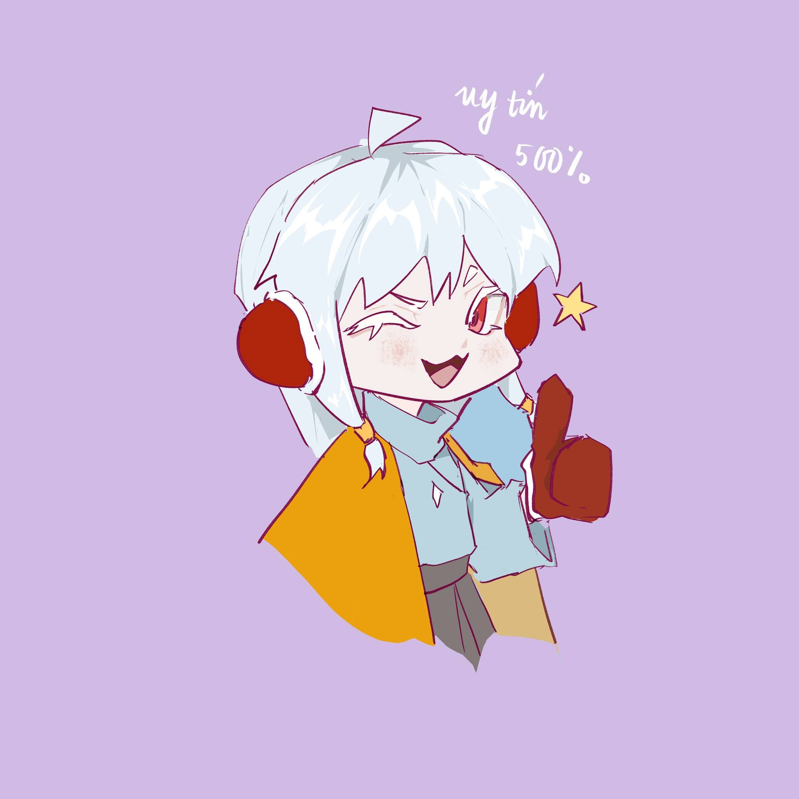

# 🎵 Xie's Musician

<p align="center">
  <strong>Autonomous High-Precision Instrument Player & Minimalist Studio for <em>Sky: Children of the Light (PC)</em></strong>
</p>

<p align="center">
  
</p>

<p align="center">
  
  
  
  
  
</p>

---

## 🌟 Giới thiệu tổng quan (Overview)

**Xie's Musician** là ứng dụng hỗ trợ chơi nhạc cụ tự động cao cấp được thiết kế riêng cho tựa game **Sky: Children of the Light (PC)**. Với kiến trúc **Floating HUD kính mờ (Dark Glassmorphism)** không viền, không icon Taskbar, ứng dụng mang lại trải nghiệm tối giản, thanh lịch và hoàn toàn không che khuất màn hình chơi game.

Ứng dụng tích hợp bộ xử lý âm học **DSP Skyline Top-Voice & Downbeat Bass Gating** độc quyền giúp chuyển đổi nhạc từ YouTube/MP3/MIDI sang cấu trúc 15 phím đàn Sky cực kỳ trong trẻo, không bị loạn nốt đệm tay trái.

---

## ✨ Tính năng nổi bật (Key Features)

### 1. 🪟 Giao diện Kép: Mini Floating HUD & Expanded Studio
- **Khởi động siêu gọn (Mini HUD):** Cửa sổ `380x115px`, góc bo tròn Win32 Region mượt mà, hiển thị tên bài, tiến trình, thời gian còn lại (`-mm:ss`), nút chuyển bài nhanh và các nút điều khiển trực tiếp.
- **Không chiếm thanh tác vụ (Taskbar-less):** Sử dụng cờ Win32 `WS_EX_TOOLWINDOW` — giữ thanh Taskbar luôn thông thoáng.
- **Studio mở rộng (`1240x780px`):** Khi bấm nút phóng to, hiển thị Visualizer dạng thác nước ánh sáng (Waterfall Light Canvas), bàn phím 15 phím kim cương Sky phản hồi thời gian thực, và bộ tổng hợp âm thanh Web Audio (Synthesizer) đa nhạc cụ: *Piano, Đàn Hạc (Harp), Sáo Trúc (Flute), Kalimba, Kèn Horn*.

### 2. 🛡️ Cơ chế Mô phỏng người (Humanized Anti-Ban)
- **BẬT (Mô phỏng ngón tay người):** Áp dụng dao động thời gian micro-jitter ngẫu nhiên (12–32ms), bấm hợp âm so le ngón tay (3–7ms), thời gian giữ phím biến thiên (38–54ms) chống phát hiện tự động.
- **TẮT (Chính xác 100%):** Đánh chính xác tuyệt đối theo từng mili-giây nhịp gốc của bản nhạc.

### 3. 🎹 Hàng đợi phát thông minh (Continuous Playback Queue)
- **Phát hàng đợi tự động vào Game:** Nhấn nút **Phát hàng đợi** (hoặc *Phát tất cả* trong Playlist) để bắt đầu chuỗi chơi nhạc liên tục. Ứng dụng tự động ẩn xuống, chuyển quyền gõ phím trực tiếp vào game Sky và đếm ngược 3s chuẩn bị.
- **Tự động chuyển bài mượt mà:** Khi bài hát hiện tại kết thúc, hệ thống tự động tải bài kế tiếp trong danh sách và tiếp tục đánh đàn mà người chơi không cần bấm phím thủ công.
- **Trộn bài (Shuffle):** Xáo ngẫu nhiên thứ tự hàng đợi theo thuật toán Fisher-Yates mà không ngắt bài đang phát.
- **Lặp lại (Loop):** Chế độ lặp vòng danh sách hàng đợi khi phát hết bài cuối cùng.
- **Kéo thả sắp xếp (`⋮⋮`):** Giữ và kéo thả biểu tượng `⋮⋮` trên từng thẻ bài hát để thay đổi thứ tự ưu tiên trong hàng đợi.

### 4. ⚙️ Hệ thống Cài đặt Phím tắt Động (Dynamic Keybinds)
- Mở bảng cài đặt hình Cờ lê (Wrench Icon) trên cả Full Mode và Mini HUD.
- Bắt phím thông minh (Interactive Key Capture) hỗ trợ các phím đặc biệt: `Right Shift`, `Left Shift`, `Right Ctrl`, `Right Alt`, `F1`–`F12`, `Space`...
- Kiểm tra xung đột phím tức thì và lưu trữ cấu hình cố định tại `settings.json`.
- **Phím tắt mặc định:**
  - `Right Shift`: Ẩn / Hiện thanh HUD bất cứ lúc nào trong game mà không ngắt nhạc.
  - `F6`: Bắt đầu phát / Tạm dừng / Tiếp tục bài hát.
  - `F8`: **Dừng khẩn cấp (Emergency Safe Stop)** — nhả toàn bộ phím ngay lập tức để bảo vệ tài khoản an toàn tuyệt đối.

### 5. 🌐 Kho Sheet Online (Hơn 14.000 bài hát)
- Tích hợp công cụ tìm kiếm trực tuyến tốc độ cao và phân loại theo nguồn cung cấp:
  - **vithai.xyz**: Toàn bộ thư viện TheVoid vithai.xyz (hơn 7.840 bài).
  - **sky-music.github.io**: Thư viện Sky Music Nightly & Specy.
  - **skysheet.store**: Thư viện Sky Sheet Store.
  - **YouTube (Chuyển soạn)**: Sheet nhạc chuyển thể chọn lọc.
  - **Cộng đồng Sky**: Bản chia sẻ từ cộng đồng quốc tế và Việt Nam.
- Tải sheet trực tiếp về máy chỉ bằng 1 cú nhấp chuột.

### 6. 🎼 Bộ tạo Sheet DSP từ YouTube, MP3 & MIDI
- **Khử bội âm tay trái (Harmonic Sieve):** Quét các tần số trầm/trung (`110Hz - 420Hz`) và triệt tiêu năng lượng hài bậc 2 ($2f$, -65%), bậc 3 ($3f$, -45%) để không tạo nốt ảo đè giai điệu.
- **Bù năng lượng tần số cao (Treble Pre-Emphasis):** Tăng cường trọng số theo tỉ lệ `(freq / 261.63)^0.85`, giúp nốt giai điệu tay phải thắng thế tiếng đệm bass của đàn Piano.
- **Skyline Top-Voice Selection:** Luôn giữ lại 100% nốt bè cao nhất trong mỗi cụm hợp âm.
- **Downbeat Bass Gating:** Lọc bỏ triệt để các nốt bè giữa gây đục âm; chỉ giữ lại 1 nốt bass trầm nhất ở các phách mạnh cách nhau tối thiểu $\ge 350\text{ms}$.
- **Căn nhịp chuẩn (Quantize 1/16 Beat):** Tự động gióng nhịp vào lưới nốt móc kép đều đặn.

---

## 🗂️ Cấu trúc thư mục dự án (Repository Structure)

```text
XieMusician/
├── _source/
│   ├── engine.py              # Engine lõi phát nhạc, DirectInput & lịch trình chính xác
│   ├── main.py                # PyWebView IPC Backend, Win32 API, Global Hotkeys
│   ├── midi_converter.py      # DSP Transcription, Skyline Purification & Audio Parsing
│   └── gui/
│       ├── index.html         # Giao diện Mini HUD, Full Studio & Modals
│       ├── style.css          # Hệ thống Dark Glassmorphism, Animations, Sleek Scrollbar
│       └── app.js             # Logic Visualizer, Audio Synth, Queue & Keybind Manager
├── Songs/                     # Thư mục chứa các bài hát mẫu (.json)
├── icon.ico                   # Icon Windows đa độ phân giải (16x16 đến 256x256)
├── icon.png                   # Brand icon cho giao diện Web/HUD
├── playlists.json             # Danh sách Playlist tùy chỉnh của người dùng
├── settings.json              # Cấu hình phím tắt và chế độ đã lưu
├── song_metadata.json         # Danh sách bài hát yêu thích & thông tin đính kèm
├── XiesMusician.py            # Entry point khởi chạy ứng dụng bằng Python
├── build_exe.py               # Script tự động đóng gói PyInstaller thành file .exe độc lập
└── README.md                  # Tài liệu hướng dẫn sử dụng
```

---

## 🚀 Hướng dẫn cài đặt & Khởi chạy (Installation & Usage)

### Cách 1: Sử dụng File thực thi đóng gói sẵn (.exe)
1. Tải bản build mới nhất hoặc tự build file `XiesMusician.exe`.
2. Khởi chạy trực tiếp `XiesMusician.exe`.
3. Vào game **Sky: Children of the Light (PC)**, cầm nhạc cụ bất kỳ.
4. Chọn bài hát từ Thư viện hoặc nạp vào **Hàng đợi phát**, bấm **`▶ Vào Game`** hoặc **`Phát hàng đợi`**. Cửa sổ sẽ tự động ẩn xuống và bắt đầu chơi nhạc!

### Cách 2: Khởi chạy từ mã nguồn Python (Developer Mode)

#### 1. Yêu cầu hệ thống:
- Hệ điều hành: **Windows 10 / 11** (64-bit)
- Python **3.10** trở lên

#### 2. Cài đặt các thư viện cần thiết:
```bash
pip install pywebview pydirectinput keyboard yt-dlp mido pythonnet
```

#### 3. Khởi chạy ứng dụng:
```bash
python XiesMusician.py
```

#### 4. Đóng gói thành file standalone `.exe`:
```bash
python build_exe.py
```
> File thực thi đầu ra sẽ xuất hiện tại thư mục gốc: `XiesMusician.exe` (~23 MB).

---

## ⌨️ Phím tắt mặc định (Default Shortcuts)

| Phím tắt | Chức năng | Mô tả chi tiết |
| :--- | :--- | :--- |
| **`Right Shift`** | **Ẩn / Hiện HUD** | Bật tắt cửa sổ nổi trong game mà không dừng phát nhạc |
| **`F6`** | **Phát / Tạm dừng** | Bắt đầu phát hoặc tạm dừng bài hát hiện tại |
| **`F8`** | **Dừng khẩn cấp** | Lập tức nhả toàn bộ phím và dừng phát hoàn toàn |

> *Lưu ý: Bạn có thể bấm vào biểu tượng **Cờ lê** trên thanh tiêu đề để đổi các phím tắt này sang bất kỳ phím nào theo thói quen.*

---

## 👤 Tác giả & Đóng góp (Author & Credits)

- **Tác giả:** [**Yue_Invincible**](https://github.com/YueInvincible)
- **Repository:** [https://github.com/YueInvincible/XieMusician](https://github.com/YueInvincible/XieMusician)
- Dành tặng cộng đồng người chơi yêu âm nhạc của tựa game **Sky: Children of the Light**! 💫
